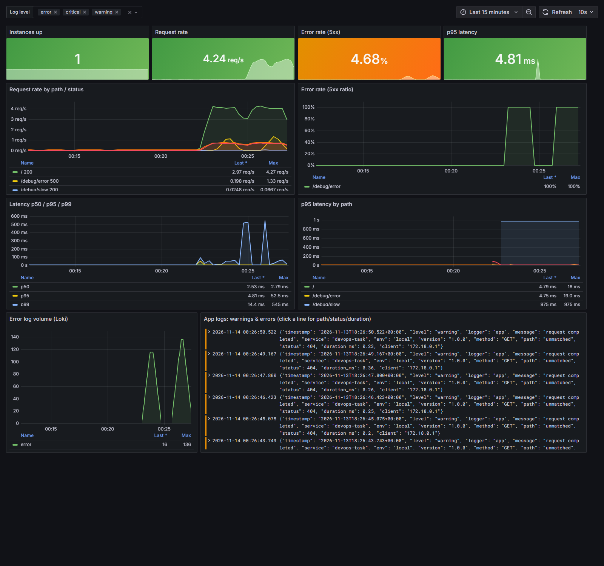
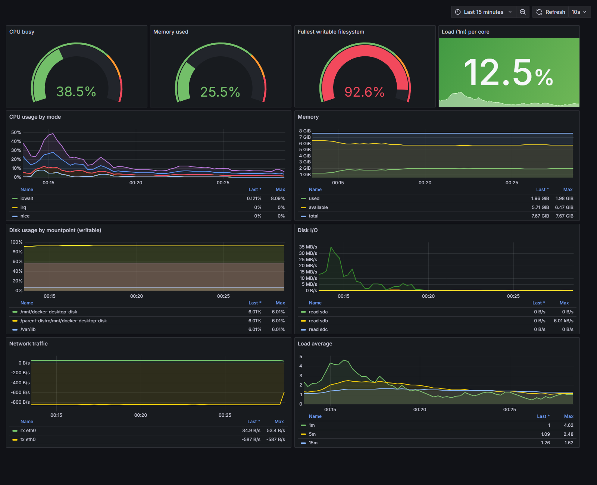
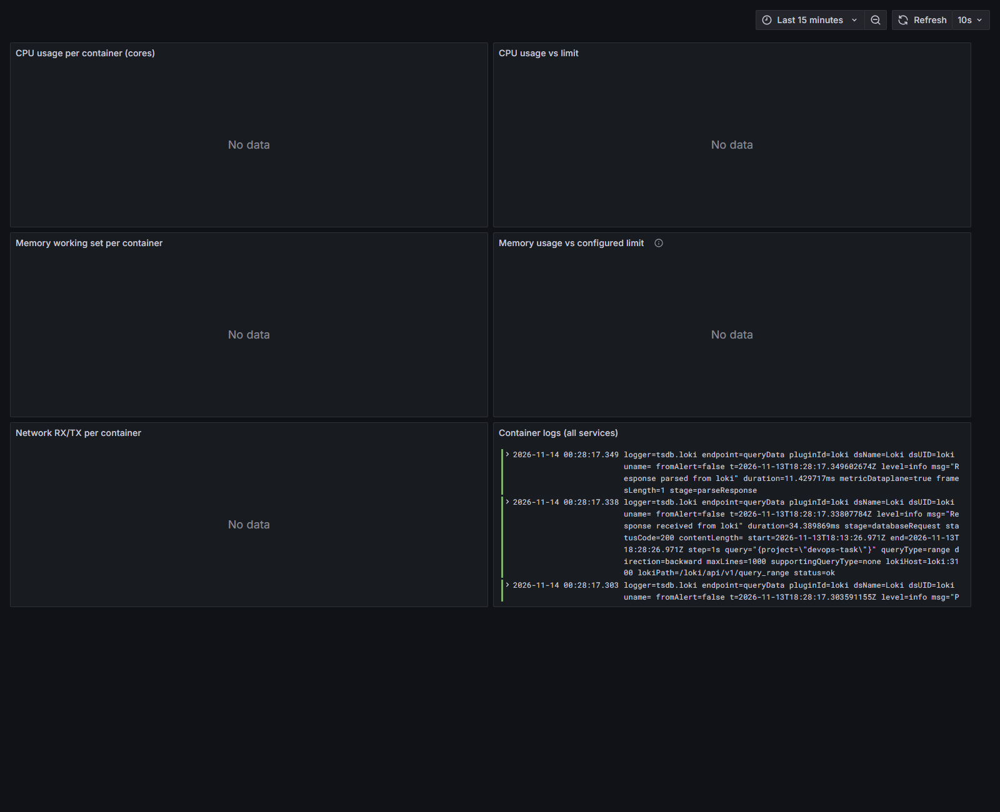
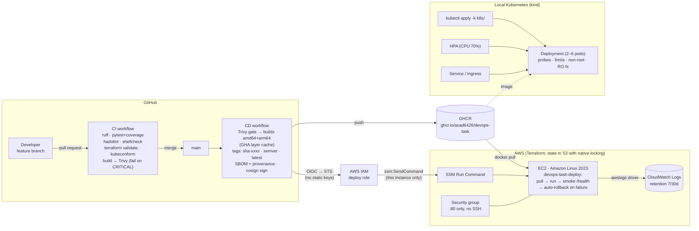
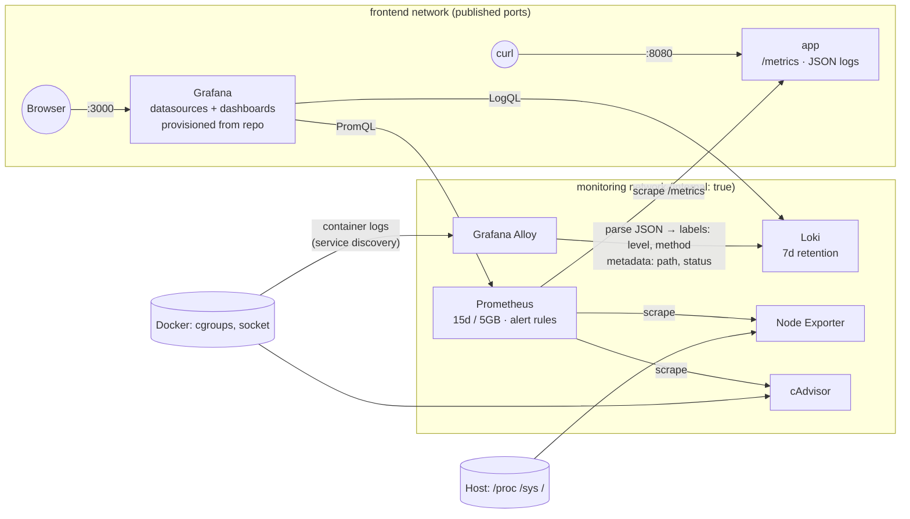

# devops-task

This project takes a small FastAPI web service and covers its whole life:

- **Container:** a hardened image (distroless, non-root, read-only filesystem)
- **CI/CD:** GitHub Actions with security gates, multi-arch builds and image signing
- **AWS:** infrastructure written in Terraform (EC2 + IAM + CloudWatch, S3 remote state)
- **Kubernetes:** a deployment with zero-downtime rollouts
- **Observability:** Prometheus, Grafana, Loki, Alloy, Node Exporter and cAdvisor, all set up from files in this repo
- **Ops script:** a host health check script

| What | Where |
|---|---|
| Application + tests | [`app/`](app/), [`tests/`](tests/) |
| Container | [`Dockerfile`](Dockerfile), [`.dockerignore`](.dockerignore), [`docker-compose.yml`](docker-compose.yml) |
| CI/CD | [`.github/workflows/ci.yml`](.github/workflows/ci.yml) (PRs), [`.github/workflows/cd.yml`](.github/workflows/cd.yml) (main) |
| Terraform (AWS) | [`terraform/`](terraform/) |
| Kubernetes | [`k8s/`](k8s/) |
| Observability | [`monitoring/`](monitoring/) |
| Health script | [`scripts/system_health.sh`](scripts/system_health.sh), [`deploy/`](deploy/) |
| Evidence | [`docs/`](docs/) (dashboard screenshots, Kubernetes rollout transcript) |

---

## Contents

1. [Quick start](#1-quick-start)
2. [Application](#2-application)
3. [Container image](#3-container-image)
4. [CI/CD pipeline](#4-cicd-pipeline)
5. [Terraform (AWS)](#5-terraform-aws)
6. [Kubernetes](#6-kubernetes)
7. [Observability](#7-observability)
8. [Health script](#8-health-script)
9. [Architecture](#9-architecture)
10. [Design decisions](#10-design-decisions)
11. [Deployment & rollback strategy](#11-deployment--rollback-strategy)
12. [Security considerations](#12-security-considerations)
13. [AWS cost estimate](#13-aws-cost-estimate)
14. [What I would improve with more time](#14-what-i-would-improve-with-more-time)
15. [Use of AI tools](#15-use-of-ai-tools)

---

## 1. Quick start

**Prerequisites:** Docker 24+ with Compose v2. For the optional parts you also need:
- Python 3.13 to run the tests
- `kubectl` and [kind](https://kind.sigs.k8s.io/) for Kubernetes
- Terraform 1.10+ and an AWS account for the cloud deployment

```bash
git clone https://github.com/asad6426/devops-task.git && cd devops-task
cp .env.example .env            # then set GRAFANA_ADMIN_PASSWORD

# App only
docker compose up -d --build
curl localhost:8080/            # {"message":"Hello from DevOps Task!","status":"running","version":"1.0.0"}

# App + full observability stack
docker compose --profile monitoring up -d --build
```

| URL | What |
|---|---|
| http://localhost:8080/ | The app (also `/health` and `/metrics`) |
| http://localhost:3000 | Grafana. Log in with `GRAFANA_ADMIN_USER` / `GRAFANA_ADMIN_PASSWORD` from `.env`. Dashboards are under **Dashboards → DevOps Task**. |

Only ports 8080 and 3000 are published. Prometheus, Loki, Alloy, Node Exporter and cAdvisor are reachable only from inside the `monitoring` network. To look at them, use `docker compose exec grafana wget -qO- http://prometheus:9090/...`, or open Grafana → Explore.

**Generate demo traffic** (the debug endpoints are on only in local Compose):

```bash
for i in $(seq 1 300); do curl -s localhost:8080/ >/dev/null; curl -s localhost:8080/debug/error >/dev/null; sleep 0.2; done
```

**Tear down:**

```bash
docker compose --profile monitoring down -v
```

---

## 2. Application

This is a FastAPI service ([`app/main.py`](app/main.py)). Uvicorn runs it via `python -m app`.

| Endpoint | Behaviour |
|---|---|
| `GET /` | Returns `{"message": "Hello from DevOps Task!", "status": "running", "version": "<APP_VERSION>"}` |
| `GET /health` | `200 {"status":"ok"}` while the app is serving. `503` before startup finishes and after shutdown begins. Used for liveness, readiness, the Docker HEALTHCHECK and deploy smoke tests. |
| `GET /metrics` | Prometheus metrics (see the table below) |

| Metric | Type | Labels |
|---|---|---|
| `http_requests_total` | counter | `method`, `path`, `status` |
| `http_request_errors_total` | counter | `method`, `path` (counts 5xx responses and unhandled exceptions) |
| `http_request_duration_seconds` | histogram | `method`, `path` |
| `http_requests_in_progress` | gauge | none |
| `app_info` | gauge | `version`, `env` |

The `path` label is the **matched route template**, never the raw URL. Anything that doesn't match a route is recorded as `path="unmatched"`. Without this, a scanner hitting random URLs would create a new time series for every URL.

**Configuration** (environment variables only, see [`app/config.py`](app/config.py)):

| Variable | Default | Notes |
|---|---|---|
| `PORT` | `8080` | |
| `LOG_LEVEL` | `INFO` | DEBUG, INFO, WARNING, ERROR or CRITICAL. Anything else makes startup fail. |
| `APP_ENV` | `local` | Environment name. Added to every log line and to `app_info`. |
| `APP_VERSION` | `0.0.0-dev` | Baked into the image at build time from [`VERSION`](VERSION). |
| `SHUTDOWN_TIMEOUT_SECONDS` | `20` | How long to drain in-flight requests after SIGTERM |
| `ENABLE_DEBUG_ENDPOINTS` | `false` | `/debug/error` and `/debug/slow`, for observability demos |

**Logging.** Every log line is one JSON object on stdout:
`{"timestamp","level","logger","message","service","env","version", ...}`.
Each request adds `method`, `path`, `status`, `duration_ms` and `client`. Successful `/health` and `/metrics` calls are logged at DEBUG, so constant probes don't flood the logs.

**Graceful shutdown.** When the app gets SIGTERM:
1. Uvicorn stops accepting new connections.
2. It waits up to `SHUTDOWN_TIMEOUT_SECONDS` for in-flight requests to finish.
3. The FastAPI lifespan hook marks the app not-ready and logs `application shutting down gracefully`.

This works because the Dockerfile uses exec form, so Python runs as PID 1 and receives the signal directly. Measured: `docker stop` completes in about 1.7 s.

**Tests:**

```bash
python -m venv .venv && . .venv/bin/activate      # Windows: .venv\Scripts\activate
pip install -r requirements-dev.txt
ruff check . && ruff format --check .
pytest                                            # 10 tests, coverage report in the terminal + coverage.xml
```

---

## 3. Container image

[`Dockerfile`](Dockerfile) uses a two-stage build:

1. **builder** (`python:3.13-slim-trixie`) installs the pinned dependencies into `/opt/deps` and pre-compiles the bytecode. Because the bytecode already exists, the runtime never has to write to the root filesystem.
2. **runtime** (`gcr.io/distroless/python3-debian13:nonroot`) contains only the Python runtime, the dependencies and the app. It has no shell and no package manager.

- **Pinned bases.** Both base images are pinned by **tag + sha256 digest**.
- **Non-root.** The runtime runs as `USER 65532:65532` (distroless `nonroot`).
- **HEALTHCHECK.** Runs `python3 -m app.healthcheck`, a tiny urllib probe (distroless has no curl or wget).
- **OCI labels.** Title, description, version, revision, created, source, license and base name.
- **`.dockerignore`** works as an allow-list: only `app/` and `requirements.txt` go into the build context.
- **Layer order.** `requirements.txt` is copied before the code, so dependency layers stay cached when only code changes.

**Final image size: 116 MB** (uncompressed, linux/amd64). The distroless Python base is most of that; the app and its dependencies add about 15 MB.

**Trivy** (HIGH + CRITICAL, fixable only) reports **0 vulnerabilities**. The first version of this image used `python3-debian12` and showed 2 CRITICAL OS findings plus 3 HIGH findings in an old Starlette. Moving to Debian 13 and current FastAPI/Starlette cleared them. The CI gate exists to catch exactly this kind of problem.

---

## 4. CI/CD pipeline

### On every pull request ([`ci.yml`](.github/workflows/ci.yml))

| Job | Steps |
|---|---|
| **lint-test** | Ruff lint and format check, then pytest with coverage. The job fails below 85% coverage (it is at about 98%). The coverage table goes to the job summary and `coverage.xml` is uploaded as an artifact. |
| **static-analysis** | Hadolint (fails on warnings), ShellCheck on `scripts/*.sh`, `terraform fmt -check` + `validate`, and kubeconform `-strict` on the rendered Kustomize output |
| **build-scan** | Buildx build with the GitHub Actions layer cache, then Trivy. Trivy prints HIGH and CRITICAL findings, and **fails the job on any fixable CRITICAL**. The job then smoke-tests the image (`/health`, `/`, `/metrics`) with a read-only root filesystem. |

### On push to `main` ([`cd.yml`](.github/workflows/cd.yml))

1. **Scan before push.** The pipeline builds the amd64 image locally and runs the Trivy CRITICAL gate. A vulnerable image never reaches the registry.
2. **Multi-arch build.** Builds `linux/amd64` + `linux/arm64` with QEMU and Buildx, using `cache-from/to: type=gha` for layer caching.
3. **Tags.** Every image gets three tags:
   - `sha-<7-char-sha>`: immutable, and the one that gets deployed
   - `<semver>` from the [`VERSION`](VERSION) file, e.g. `1.0.0`
   - `latest`: a convenience tag only, never deployed
4. **Push** to GHCR using the job's short-lived `GITHUB_TOKEN`, with **SBOM and provenance attestations** (`sbom: true`, `provenance: mode=max`).
5. **Sign** the image digest with **Cosign keyless** (GitHub OIDC → Sigstore).
6. **Deploy** (`deploy-ec2` job):
   - **GitHub OIDC → AWS STS** gives short-lived credentials for the deploy role. No access keys exist.
   - `aws ssm send-command` runs [`devops-task-deploy <image>:sha-xxxx`](scripts/ec2-deploy.sh) on the instance.
   - The instance pulls the image, replaces the container and smoke-tests `/health` (20 tries, 3 s apart).
   - **If the smoke test fails, the instance restarts the previous image by itself**, and the SSM command exits non-zero. That turns the workflow red and prints the container logs.
   - An optional final check calls `$APP_URL/health` from the runner.

`concurrency: cd-main` with `cancel-in-progress: false` means two deploys never overlap, and a running deploy is never killed half-way.

### Required configuration (nothing is hardcoded)

| Name | Kind | Where it comes from |
|---|---|---|
| `GITHUB_TOKEN` | automatic secret | Pushes to GHCR (`packages: write`) |
| `AWS_DEPLOY_ROLE_ARN` | repository **variable** | `terraform output github_deploy_role_arn` |
| `EC2_INSTANCE_ID` | repository **variable** | `terraform output instance_id` |
| `AWS_REGION` | repository variable (optional) | Defaults to `ap-southeast-1` |
| `APP_URL` | repository variable (optional) | `terraform output public_url`, used for the external smoke test |

No AWS **secrets** are needed at all: the role ARN is not sensitive, and OIDC replaces access keys. Set the variables with:

```bash
gh variable set AWS_DEPLOY_ROLE_ARN --body "$(terraform -chdir=terraform output -raw github_deploy_role_arn)"
gh variable set EC2_INSTANCE_ID     --body "$(terraform -chdir=terraform output -raw instance_id)"
gh variable set APP_URL             --body "$(terraform -chdir=terraform output -raw public_url)"
```

Until these variables exist, `deploy-ec2` is **skipped** (by its `if:` condition) rather than failing. The rest of the pipeline still builds, scans, pushes and signs.

**Evidence:**
- [PR #7 checks](https://github.com/asad6426/devops-task/pull/7) show the CI workflow green on a pull request. The first run failed because a pinned action tag no longer existed; that was fixed in the PR.
- The [CD run on `main`](https://github.com/asad6426/devops-task/actions/runs/43484540447) built, scanned, pushed and signed `ghcr.io/asad6426/devops-task:1.0.0` / `sha-…` for `linux/amd64` and `linux/arm64`. Check with `docker buildx imagetools inspect ghcr.io/asad6426/devops-task:1.0.0`.

> **Status:** I wrote and validated the AWS deploy path (`terraform validate`, ShellCheck on the deploy script), but I did **not** run `apply` against a real AWS account during the assessment window. That means there are no AWS deploy logs yet. See [§5](#5-terraform-aws).

---

## 5. Terraform (AWS)

```
terraform/
├── bootstrap/            # one-time: versioned, encrypted, private S3 bucket for state
├── versions.tf           # provider + partial S3 backend (use_lockfile = true)
├── variables.tf          # environment, region, instance type, CIDRs, retention, ...
├── main.tf               # SG, CloudWatch log group, instance IAM role/profile, EC2
├── github_oidc.tf        # GitHub OIDC provider + least-privilege deploy role
├── outputs.tf
├── templates/user_data.sh.tftpl
├── envs/{staging,production}.tfvars
└── backend/{staging,production}.hcl
```

| Requirement | Implementation |
|---|---|
| **EC2 in a VPC** | Amazon Linux 2023, AMI resolved from SSM Parameter Store, default VPC. **IMDSv2 required** with hop limit 1, so containers can't reach the instance credentials. Encrypted gp3 root volume. |
| **Security group** | Inbound only on the app port (80), from `allowed_http_cidrs`. **No port 22**: shell access is through SSM Session Manager. Outbound open (GHCR, SSM, CloudWatch). |
| **IAM instance profile** | `AmazonSSMManagedInstanceCore`, plus `logs:CreateLogStream`/`PutLogEvents`/`DescribeLogStreams` on **this environment's log group only**. No ECR permissions, because images come from public GHCR. **No static keys anywhere.** |
| **Bootstrap** | `user_data` installs Docker, writes `/opt/devops-task/deploy.conf`, installs the deploy script, and deploys `var.app_image` |
| **Logs → CloudWatch** | Docker `awslogs` log driver → `/devops-task/<env>/app`. Retention: `log_retention_days` (staging 7, production 30). |
| **Remote state + locking** | S3 backend with **native S3 locking** (`use_lockfile = true`, Terraform 1.10+), so no DynamoDB table is needed. One state key per environment. The bucket is versioned, encrypted and blocks public access. |
| **staging / production** | Same code, different `envs/*.tfvars` + `backend/*.hcl`. Separate state, names, log groups and roles. |
| **CI deploy role** | Trusted only for `repo:asad6426/devops-task` on `main` or the matching GitHub environment. It can only `ssm:SendCommand` with `AWS-RunShellScript` **on this one instance**. |

**Run it:**

```bash
# 0. one-time state bucket
cd terraform/bootstrap
terraform init && terraform apply -var state_bucket_name=<unique-bucket-name>

# 1. staging (put the bucket name in backend/staging.hcl first)
cd ..
terraform init -backend-config=backend/staging.hcl
terraform plan  -var-file=envs/staging.tfvars -out=staging.tfplan
terraform apply staging.tfplan
terraform output

# 2. production (separate state)
terraform init -reconfigure -backend-config=backend/production.hcl
terraform plan -var-file=envs/production.tfvars

# clean up
terraform destroy -var-file=envs/staging.tfvars
```

**Validation done:** `terraform fmt -check -recursive` and `terraform validate` pass for both the root module and `bootstrap/`, and CI runs them on every PR. I could not run `plan` or `apply` because I had no AWS account or credentials set up in the assessment window. A reviewer with credentials can run the commands above unchanged after setting the bucket name.

---

## 6. Kubernetes

Plain YAML assembled with Kustomize, in [`k8s/`](k8s/):

| File | What it contains |
|---|---|
| `namespace.yaml` | Namespace with the **Pod Security Standard `restricted`** enforced |
| `deployment.yaml` | 2 replicas; `RollingUpdate` with `maxUnavailable: 0`, `maxSurge: 1`; startup, readiness and liveness probes on `/health`; requests (50m CPU / 64Mi) and limits (250m / 192Mi); `runAsNonRoot`, `readOnlyRootFilesystem`, all capabilities dropped, `seccompProfile: RuntimeDefault`, no service-account token; `preStop` sleep so endpoints update before SIGTERM; an `emptyDir` for `/tmp` |
| `service.yaml` | ClusterIP on port 80 |
| `ingress.yaml` | ingress-nginx, host `devops-task.localtest.me` |
| `configmap.yaml` | `PORT`, `LOG_LEVEL`, `APP_ENV`, `SHUTDOWN_TIMEOUT_SECONDS` |
| `hpa.yaml` | 2 to 6 replicas at 70% CPU, with a 5-minute scale-down stabilization window |
| `pdb.yaml` | `minAvailable: 1` |
| `kustomization.yaml` | Kustomize **`secretGenerator`** for the Secret (explained below) |

**Secrets approach.** No Secret manifest is committed:
- `secretGenerator` builds `devops-task-secret` from `k8s/secret.env`, which is git-ignored. Copy it from `secret.env.example`.
- Kustomize adds a content hash to the Secret's name. Changing a value therefore rolls the pods automatically.
- In production this would be replaced by External Secrets Operator reading AWS Secrets Manager (see below).

**Run it locally (kind):**

```bash
kind create cluster --name devops
docker build --build-arg APP_VERSION=1.0.0 -t ghcr.io/asad6426/devops-task:1.0.0 .
docker build --build-arg APP_VERSION=1.1.0 -t ghcr.io/asad6426/devops-task:1.1.0 .
kind load docker-image ghcr.io/asad6426/devops-task:1.0.0 ghcr.io/asad6426/devops-task:1.1.0 --name devops

# metrics-server, needed by the HPA (kind needs --kubelet-insecure-tls)
kubectl apply -f https://github.com/kubernetes-sigs/metrics-server/releases/download/v0.7.2/components.yaml
kubectl -n kube-system patch deploy metrics-server --type=json \
  -p '[{"op":"add","path":"/spec/template/spec/containers/0/args/-","value":"--kubelet-insecure-tls"}]'

cp k8s/secret.env.example k8s/secret.env
kubectl apply -k k8s/
kubectl -n devops-task rollout status deploy/devops-task

# Access without an ingress controller:
kubectl -n devops-task port-forward svc/devops-task 8081:80   # -> http://localhost:8081
# Or install ingress-nginx for kind and use http://devops-task.localtest.me
```

### Zero-downtime rolling update and rollback

[`scripts/k8s-demo.sh`](scripts/k8s-demo.sh) starts a load generator **inside the cluster**. It calls the Service every 50 ms for 150 s. While it runs, the script:
1. updates the image 1.0.0 → 1.1.0
2. rolls back with `kubectl rollout undo`
3. counts every request that didn't return 200

The full transcript is in [`docs/k8s-demo.txt`](docs/k8s-demo.txt). Excerpt:

```text
$ kubectl -n devops-task set image deploy/devops-task app=ghcr.io/asad6426/devops-task:1.1.0
deployment.apps/devops-task image updated
$ kubectl -n devops-task rollout status deploy/devops-task --timeout=180s
Waiting for deployment "devops-task" rollout to finish: 1 out of 2 new replicas have been updated...
Waiting for deployment "devops-task" rollout to finish: 1 old replicas are pending termination...
deployment "devops-task" successfully rolled out
$ curl /
{"message":"Hello from DevOps Task!","status":"running","version":"1.1.0"}

$ kubectl -n devops-task rollout undo deploy/devops-task
deployment.apps/devops-task rolled back
$ kubectl -n devops-task rollout status deploy/devops-task --timeout=180s
deployment "devops-task" successfully rolled out
$ curl /
{"message":"Hello from DevOps Task!","status":"running","version":"1.0.0"}

$ kubectl logs loadgen
RESULT ok=2186 fail=0          <- 0 failed requests across both rollouts
```

Three things together make this zero-downtime:
- `maxUnavailable: 0`: a new pod must be Ready before an old one is removed.
- The readiness probe.
- The `preStop` sleep plus graceful SIGTERM handling, so in-flight requests finish.

### How this would change on EKS

| Concern | Local (kind) | Production on EKS |
|---|---|---|
| Ingress | ingress-nginx / port-forward | **AWS Load Balancer Controller** (ALB Ingress, ACM TLS certs, WAF), plus ExternalDNS for Route 53 |
| Secrets | Kustomize `secretGenerator` from a git-ignored file | **External Secrets Operator** + AWS Secrets Manager/SSM, or Secrets Store CSI driver; KMS envelope encryption of etcd secrets |
| Pod AWS access | none | **IRSA / EKS Pod Identity**: one IAM role per service account, no node-wide credentials |
| Node scaling | single node | **Karpenter** (or Cluster Autoscaler) across 3 AZs; HPA for pods; topology spread across zones |
| Images | `kind load` | ECR or GHCR with pull-through cache; Kyverno/admission policy that **verifies Cosign signatures** |
| Delivery | `kubectl apply -k` | GitOps (**Argo CD**), with progressive delivery via **Argo Rollouts** canaries gated on Prometheus error-rate analysis |
| Observability | Compose stack | kube-prometheus-stack, Loki in simple-scalable mode on S3, Alloy DaemonSet, or Amazon Managed Prometheus/Grafana |
| Policy & network | PSS `restricted` label | Same, plus NetworkPolicies (VPC CNI network policy), PDBs, priority classes, resource quotas |

---

## 7. Observability

Everything is defined in [`docker-compose.yml`](docker-compose.yml) (profile `monitoring`) and provisioned from [`monitoring/`](monitoring/). Nothing is configured by hand in a UI.

```
monitoring/
├── prometheus/prometheus.yml   # scrape configs, 15d / 5GB retention set via CLI flags
├── prometheus/alerts.yml       # 6 alert rules
├── loki/loki.yml               # TSDB schema v13, 7-day retention via the compactor
├── alloy/config.alloy          # Docker discovery -> JSON parsing -> Loki
└── grafana/
    ├── provisioning/datasources/datasources.yml   # Prometheus + Loki, fixed UIDs
    ├── provisioning/dashboards/dashboards.yml
    └── dashboards/{application,host,containers}.json
```

### Metrics

Prometheus scrapes:
- `app:8080/metrics`
- `node-exporter:9100`
- `cadvisor:8080`
- itself, Loki and Alloy

It keeps data for **15 days or 5 GB, whichever comes first** (`--storage.tsdb.retention.time/size`). The cAdvisor job drops every metric family the dashboards and alerts don't use (`metric_relabel_configs` with `keep`). That removes most of cAdvisor's series.

### Logs

1. Alloy discovers every container through the Docker API (`discovery.docker` + `loki.source.docker`).
2. It sets three labels: `container`, `service` (the Compose service name) and `project`.
3. For `service="app"` only, it parses the JSON body and uses the app's own timestamp.

Then it splits the parsed fields:

| Field | Stored as | Why |
|---|---|---|
| `level` | **label** | Only 5 possible values, and it's the main thing people filter on |
| `method` | **label** | Only a handful of values |
| `path` | structured metadata | Unbounded: any scanner can invent URLs. As a label it would create a new stream per URL. As metadata it is still filterable: `{service="app"} \| path="/health"` |
| `status` | structured metadata | About 60 possible values, and it's usually combined with `level` anyway |
| `duration_ms`, `client` | log body | Unique per line; read with `\| json` |

A rough upper bound for the app is `5 levels × ~4 methods` = about 20 streams. Loki keeps logs for **7 days** (`limits_config.retention_period: 168h` with the compactor's retention enabled).

### Dashboards

All dashboards are provisioned as code and read-only in the UI.

| Dashboard | Panels |
|---|---|
| **Application** | Instances up, request rate, 5xx ratio and p95 stats; request rate by path/status; error ratio by path; latency p50/p95/p99; p95 by path; **Loki error-log volume and a Loki log panel (filterable by level) right below the metrics** |
| **Host** | CPU, memory, fullest writable filesystem gauges; load per core; CPU by mode; memory; disk usage per mount; disk I/O; network; load average |
| **Containers** | CPU per container (cores and % of limit); memory working set; **memory as % of the configured limit**; network per container; container logs |

**Application:**


**Host:**


**Containers:**


> **Known limitation on Docker Desktop: the Containers dashboard is empty in the screenshot.** Newer Docker Desktop releases store images with the **containerd image store**. cAdvisor (up to v0.53) then can't map a container to its read-write layer: it logs `failed to identify the read-write layer ID` and exports only the root cgroup. On a normal Linux Docker Engine with `overlay2` (an EC2 host, CI runners, any VM), the same configuration exports per-container `name` labels and the dashboard fills in. On Docker Desktop you can turn off *Settings → General → "Use containerd for pulling and storing images"*. The Prometheus scrape, metric filter, dashboard queries and the `ContainerMemoryNearLimit` alert don't depend on this. They use the standard `container_memory_working_set_bytes` / `container_spec_memory_limit_bytes` series.

### Alerting rules ([`alerts.yml`](monitoring/prometheus/alerts.yml))

| Alert | Condition | `for` | Why this threshold and duration |
|---|---|---|---|
| **AppInstanceDown** (critical) | `up{job="app"} == 0` | 1m | Scrapes run every 15s, so 1m means about 4 missed scrapes. That rides out a container restart or a single slow scrape, and still pages within a minute of a real outage. |
| **AppHighErrorRate** (critical) | 5xx / total > **5%** over 5m **and** traffic > 0.1 req/s | 5m | 5% is far above normal for a stateless service (normally ~0%), but below "everything is broken", so it catches partial failures such as one bad route. The traffic floor stops 1 error out of 3 requests at 3 a.m. from paging anyone. 5m filters out short blips after a deploy. |
| **AppHighLatencyP95** (warning) | p95 > **500 ms** | 10m | The endpoints answer in about 5 ms, so 500 ms is a 100× regression and clearly something users notice. It's a warning, not a page, and 10m avoids noise from GC pauses or cold starts. |
| **HostDiskUsageHigh** (warning) | writable FS > **80%** | 10m | 80% leaves time to act before the 100% failure modes: Docker can't pull, Loki or Prometheus can't write. 10m ignores short spikes from image pulls and compactions. Read-only mounts are excluded. |
| **HostHighCpuUsage** (warning) | CPU > **90%** | 15m | Short CPU spikes are normal. 15 minutes of saturation means a capacity or runaway-process problem. |
| **ContainerMemoryNearLimit** (warning) | working set / limit > **90%** | 5m | The kernel OOM-kills at 100%. 90% held for 5 minutes points to a leak or an undersized limit, not a single large request, and still leaves time to act. |

On the local stack I watched `HostDiskUsageHigh` fire (the Docker Desktop disk really was 92% full) and `AppHighErrorRate` go to *pending* while `/debug/error` was being called. Severity labels are set so that Alertmanager could route critical alerts to a pager and warnings to chat (see [§14](#14-what-i-would-improve-with-more-time)).

### Hygiene and security

- **Grafana admin credentials** come from `.env`, which is git-ignored, through `${GRAFANA_ADMIN_USER:?}`/`${GRAFANA_ADMIN_PASSWORD:?}`. Compose **refuses to start** if they aren't set. Sign-up is disabled.
- **Network exposure.** `monitoring` is an `internal: true` network: no published ports and no route out. Only `app` (8080) and `grafana` (3000) are also on the `frontend` network and publish ports.
- **Every image is pinned** to an exact version. The app's base images are also pinned by digest.
- **Every service has** a resource limit, `no-new-privileges` and log rotation (`json-file`, 3×10 MB).

**Host access granted to the exporters:**

| Component | Access | Why |
|---|---|---|
| node-exporter | `pid: host`; `/` mounted read-only at `/host` with `--path.rootfs=/host`; `read_only: true`; all capabilities dropped; not privileged | It needs the host's `/proc` and `/sys` and every mounted filesystem to report host CPU, memory, disk and network. Nothing is writable. On a plain Linux host add `,rslave` to the mount so filesystems mounted later are visible too (Docker Desktop rejects `rslave`). |
| cAdvisor | `privileged: true`, `cgroup: host`, `/dev/kmsg`, read-only mounts of `/`, `/var/run`, `/sys`, `/var/lib/docker`, `/dev/disk` | It reads every container's cgroup statistics (needs the host cgroup namespace on cgroup v2), container metadata from the Docker socket and layer directories, and OOM events from `/dev/kmsg`. `privileged` is the documented upstream requirement. Every mount is read-only, and cAdvisor sits on the internal network only. |
| Alloy | `/var/run/docker.sock` read-only | Docker service discovery and log tailing. The socket is still powerful, so in production I'd use a socket proxy that allows only `GET /containers` and `/logs`, or read `/var/lib/docker/containers/*/*.log` from the filesystem instead. |

### Walkthrough: "An error spike appears on the Application dashboard. How do you find the cause?"

1. **Scope it.** On the **Application** dashboard, check the *Error rate by path* panel to see which route is failing. Check *Request rate by path/status* to see whether it's 5xx (our fault) or 4xx (the client's). Check whether *Instances up* dropped, and whether latency rose at the same time. Higher latency points to a slow dependency or saturation; no latency change points to a code path throwing errors.
2. **Read the logs in the same view.** The Loki panel underneath is already filtered to `level=~"error|critical|warning"`. Narrow the time range to the spike and expand a line. The JSON has `path`, `status`, `duration_ms`, and for unhandled errors the full `exception` traceback. To focus further, use **Explore** with `{service="app", level="error"} | path="/debug/error" | json`.
3. **Did a release cause it?** Every log line and the `app_info` metric carry `version`. If the spike starts exactly when `version` changes, it's a bad release. **Roll back** (EC2: re-run the deploy with the previous `sha-` tag, or let the automatic rollback handle it; K8s: `kubectl rollout undo`).
4. **Is it the infrastructure?** On the **Containers** dashboard, look for memory near the limit (OOM kills cause 5xx and restarts) or CPU throttling. On the **Host** dashboard, look for a full disk, memory pressure or CPU saturation. Check whether `ContainerMemoryNearLimit` or `HostDiskUsageHigh` fired too.
5. **Confirm the fix.** After the rollback or fix, the error ratio should drop below 5%. `AppHighErrorRate` then resolves by itself.

---

## 8. Health script

[`scripts/system_health.sh`](scripts/system_health.sh) needs only Bash 4+, coreutils, procps and `/proc`.

```console
$ ./scripts/system_health.sh --help
$ ./scripts/system_health.sh --disk 80 --cpu 90 --mem 85            # human-readable output
$ ./scripts/system_health.sh --json --log-file /var/log/system-health/health_log.txt
$ HEALTH_WEBHOOK_URL=https://discord.com/api/webhooks/... ./scripts/system_health.sh -q
```

- **What it collects:**
  - CPU %, measured over 1 s from `/proc/stat`, so `sysstat` isn't needed
  - memory %, based on `MemAvailable`
  - usage of every real mounted filesystem (pseudo filesystems excluded)
  - load average
  - the top 5 processes by memory
- **Log file.** Appends a timestamped entry to `health_log.txt` (default `./health_log.txt`; override with `--log-file` or `HEALTH_LOG_FILE`). Use `--json` for one JSON object per run.
- **Thresholds.** `--cpu/--mem/--disk` print `[WARNING]` lines, and anything at or above `--critical` (default 95) prints `[CRITICAL]`. Warnings also go to stderr and, if `HEALTH_WEBHOOK_URL` is set, to a Slack/Discord webhook (bonus).
- **Exit codes:**
  - `0`: healthy
  - `1`: warning
  - `2`: critical
  - `3`: bad usage or runtime error
- **Log rotation.** When the log passes `--max-bytes` (default 1 MiB), it shifts `health_log.txt` → `.1` … `.N` and keeps `--keep` files (default 5).
- **Robustness.** Uses `set -euo pipefail`, validates every numeric flag, rejects unknown options, checks required commands and `/proc` up front, and passes ShellCheck with no warnings (CI enforces this).

**Scheduling every 5 minutes:**

```bash
sudo install -m 0755 scripts/system_health.sh /usr/local/bin/system_health.sh
sudo mkdir -p /var/log/system-health

# Option A: systemd timer (preferred: logs in journald, Persistent=true catches up after downtime)
sudo cp deploy/systemd/system-health.{service,timer} /etc/systemd/system/
sudo systemctl daemon-reload && sudo systemctl enable --now system-health.timer
systemctl list-timers system-health.timer

# Option B: cron
sudo cp deploy/cron/system-health /etc/cron.d/system-health
```

The systemd unit treats exit codes 1 and 2 as success (`SuccessExitStatus=1 2`), so a warning doesn't mark the unit as failed. It is also sandboxed with `ProtectSystem=strict` and `NoNewPrivileges`.

---

## 9. Architecture



**Observability data flow (local Compose stack):**



---

## 10. Design decisions

| Decision | Choice | Trade-off |
|---|---|---|
| **Language** | Python + FastAPI | Fast to write and test, and the official `prometheus_client` is mature. Go would give a ~10 MB static image, but this service has no performance requirement that justifies it. |
| **Base image** | **Distroless** (`python3-debian13:nonroot`) over Alpine | No shell or package manager means a much smaller attack surface and fewer CVEs to triage. It uses glibc, so it runs the standard manylinux wheels; Alpine's musl often forces source builds. Downsides: you can't `docker exec sh` into it (use `kubectl debug` with an ephemeral container), and HEALTHCHECK needs a Python probe. Alpine would be about 30 MB smaller, but I value the security profile more. |
| **Deploy target** | **EC2 + Docker** (as the task asks) | Cheapest and simplest to reason about, and Terraform plus one script cover everything. **ECS Fargate** would add managed rollouts, service health and autoscaling without managing hosts. That's my choice for a real single service of this size. **EKS** pays off once there are many services and a platform team (control plane about $73/month plus operational overhead). |
| **Deploy mechanism** | **SSM Run Command** over SSH | No inbound port 22, no SSH keys in GitHub, every command audited in CloudTrail, and the IAM policy is limited to one instance and one document. |
| **Rollback** | Done **on the instance** by the deploy script | Rollback still happens if the CI runner dies mid-deploy, and the instance always knows the last image that passed (`/opt/devops-task/current_image`). |
| **Registry** | GHCR | Free for public images, uses `GITHUB_TOKEN` (no extra credentials), and stores signatures and attestations next to the image. Switching to ECR would mean adding `ecr:GetAuthorizationToken`/`BatchGetImage` to the instance role and an ECR login step. |
| **Tagging** | `sha-<7>` (immutable, deployed) + `X.Y.Z` from `VERSION` + `latest` (convenience only) | The commit SHA tag makes every deploy traceable and repeatable. The semver tag is what humans talk about. Deploys never use `latest`. |
| **Secrets** | GitHub OIDC (no AWS keys); `GITHUB_TOKEN` for GHCR; `.env` for local Grafana; Kustomize `secretGenerator` from a git-ignored file for K8s | Nothing secret is committed or long-lived. In production: AWS Secrets Manager + External Secrets Operator. |
| **Terraform state** | S3 + **native S3 locking** (`use_lockfile`) | Terraform 1.10 replaced the DynamoDB lock table with this. One less resource to create and pay for. |
| **Environments** | Same root module + per-environment `tfvars`/backend file | Simple, and the plan output for each environment is explicit. With more environments or modules I'd move to a module plus thin per-environment roots, or Terragrunt. |
| **Log labels** | `level`, `method`, `service`, `container`, `project` as labels; `path`, `status` as structured metadata | Keeps the Loki stream count bounded while every field stays queryable (details in [§7](#7-observability)). |
| **Metrics `path` label** | Route template + `unmatched` | Same reasoning on the Prometheus side: an unbounded label breaks Prometheus. |

---

## 11. Deployment & rollback strategy

**How a release reaches production:**

1. **Branch → PR.** CI must pass: lint, tests at ≥85% coverage, Dockerfile/shell/Terraform/K8s checks, the Trivy CRITICAL gate, and a smoke test of the built image. Turn on branch protection so `main` requires these checks and a review.
2. **Merge to `main`.**
   - CD scans again before pushing, builds multi-arch, pushes `sha-xxxx` + semver, attaches SBOM and provenance, and signs the image.
   - It deploys **the immutable `sha-` tag to staging** (GitHub environment `staging`).
   - The instance smoke-tests `/health`, and the runner checks `$APP_URL/health` from outside.
3. **Promote to production.** Production is the same Terraform with `envs/production.tfvars`. The deploy job would run again against the `production` GitHub environment with **required reviewers**, using the **same image digest** that passed staging. Nothing is rebuilt.
4. **Release versioning.** Bump `VERSION` in the PR, which makes the `X.Y.Z` tag. Tag the git commit `vX.Y.Z` for the changelog.

**Rollback:**

| Situation | Action |
|---|---|
| New EC2 container fails its health check | **Automatic.** `devops-task-deploy` restarts the previous image within about 60 s, and the workflow goes red with the container logs. |
| Bad release passes health checks but misbehaves (error-rate alert, bad metrics) | Re-run the CD workflow's deploy for the previous `sha-` tag, or run `devops-task-deploy ghcr.io/asad6426/devops-task:sha-<previous>` through SSM. The previous image is still cached on the host, so it takes seconds. |
| Kubernetes | `kubectl -n devops-task rollout undo deploy/devops-task` (shown above). With GitOps: `git revert` and let Argo CD sync. |
| Infrastructure change | Revert the Terraform commit and `plan`/`apply`. State is versioned in S3, so an earlier state can be restored. |

Not done yet but next for EC2: blue/green across two instances behind an ALB (or ECS rolling deploys with circuit-breaker rollback), so the swap itself causes no downtime. Today the single-instance restart drops traffic for about 1–2 s.

---

## 12. Security considerations

- **Secrets management.**
  - No secret in git: `.env` and `k8s/secret.env` are git-ignored, and only `*.example` templates are committed.
  - CI uses GitHub OIDC → STS for AWS (credentials last 1 hour and are limited to `main` of this repo) and the job-scoped `GITHUB_TOKEN` for GHCR.
  - Grafana won't start without admin credentials supplied from the environment.
- **Image security.**
  - Distroless, non-root UID 65532, read-only root filesystem, all capabilities dropped, `no-new-privileges`.
  - Base images pinned by digest.
  - Trivy runs on every PR and again before every push; any fixable CRITICAL fails the pipeline.
  - SBOM and SLSA provenance attestations; Cosign keyless signatures (verify with `cosign verify ghcr.io/asad6426/devops-task@<digest> --certificate-identity-regexp 'https://github.com/asad6426/devops-task/.*' --certificate-oidc-issuer https://token.actions.githubusercontent.com`).
- **Supply chain.**
  - Dependencies are pinned in `requirements*.txt`.
  - Actions are pinned to major versions. Hardening step: pin to commit SHAs and let Dependabot/Renovate update them.
- **IAM (least privilege).**
  - **Instance role:** only SSM core plus writing to its own log group.
  - **Deploy role:** only `ssm:SendCommand(AWS-RunShellScript)` on that one instance, plus reading command results.
  - **Trust policy:** pinned to the repo, branch and environment.
  - IMDSv2 required with hop limit 1.
- **Network exposure.**
  - EC2: only the app port is open, and the source CIDRs are a variable. No SSH (Session Manager instead).
  - Local stack: only 8080 and 3000 are published. The monitoring network is `internal`.
  - Kubernetes: ClusterIP + Ingress. Next step: NetworkPolicies that allow only ingress-controller → app.
- **Kubernetes workload.**
  - PSS `restricted` enforced on the namespace.
  - Pods run with `seccomp: RuntimeDefault`, no service-account token mount, and a PDB.
- **Data at rest.** Encrypted EBS volume, and an encrypted, versioned, private S3 state bucket.
- **Known gap.** The app has no TLS of its own. Production would terminate TLS at an ALB with ACM certificates, or at the ingress with cert-manager.

---

## 13. AWS cost estimate

Rough monthly estimate, on-demand prices, ap-southeast-1 (Singapore):

| Item | As built (single instance) | Production-grade |
|---|---|---|
| EC2 | 1 × t3.small ≈ **$19** | 2 × t3.small in an ASG across 2 AZs ≈ **$38** |
| EBS gp3 | 20 GB ≈ **$2** | 2 × 20 GB ≈ **$4** |
| Public IPv4 | 1 × $0.005/h ≈ **$4** | ALB-only public IPs (included below) |
| Application Load Balancer | n/a | ≈ **$20** + LCU ≈ **$25** |
| CloudWatch Logs | ~5 GB ingested + stored ≈ **$4** | ~20 GB ≈ **$15** |
| Data transfer out | ~10 GB ≈ **$1** | ~50 GB ≈ **$6** |
| S3 state, SSM, IAM, OIDC | ≈ **$0** | ≈ **$0** |
| Monitoring host (Prometheus/Loki/Grafana on 1 × t3.medium + 50 GB) | (runs locally) | ≈ **$40** |
| **Total** | **≈ $30 / month** | **≈ $130 / month** |

For comparison: ECS Fargate (2 × 0.25 vCPU/0.5 GB tasks) is about $18 plus the ALB. EKS adds $73/month for the control plane before any nodes. Savings Plans or Reserved Instances cut EC2 cost by about 30–40%. Graviton (t4g) saves about 20% more, and the image is already built for arm64.

---

## 14. What I would improve with more time

1. **Run the AWS part for real.** `terraform apply` for staging, a green CD run with the SSM deploy, a deliberately broken release to capture the auto-rollback in the logs, then `destroy`.
2. **Alertmanager** with routing: `critical` → PagerDuty/Discord, `warning` → a chat channel, plus inhibition rules (for example, mute `AppHighErrorRate` while `AppInstanceDown` is firing). Alerts are already labeled by severity for this.
3. **Zero-downtime EC2 deploys.** Two instances behind an ALB with blue/green target-group switching, or move to ECS Fargate with deployment circuit-breaker rollback.
4. **Helm chart** with `values-staging.yaml`/`values-production.yaml`, deployed by Argo CD, with Argo Rollouts canaries gated on the same error-rate PromQL as the alert.
5. **Monitoring in Kubernetes** with `kube-prometheus-stack` + Loki + Alloy DaemonSet, and a `ServiceMonitor` for the app.
6. **OpenTelemetry tracing** to Grafana Tempo, with trace IDs in the JSON logs so you can jump from a log line to its trace.
7. **SLOs.** A 99.9% availability SLO with multi-window burn-rate alerts instead of fixed-threshold error alerts.
8. **Hardening.**
   - Pin GitHub Actions to SHAs and add Renovate.
   - Add a Docker socket proxy for Alloy.
   - Add NetworkPolicies, and Kyverno to verify image signatures at admission.
   - Run `checkov`/`tflint` in CI.
9. **Ansible playbook** for OS hardening (unattended upgrades, auditd, sysctl, CIS basics) that also installs `system_health.sh` and its timer.
10. **cAdvisor on Docker Desktop.** Track the upstream fix for the containerd image store, or switch to the Docker Engine metrics endpoint for local development.

---

## 15. Use of AI tools

I used an AI coding assistant (Claude Code) throughout this task to:
- draft code and configuration
- look up current image versions and digests
- debug problems I hit along the way: the cAdvisor cgroup-namespace and containerd issue, the `rslave` mount error on Docker Desktop, the Trivy findings that led me to move the base image to Debian 13, and the hardcoded `APP_VERSION` that hid the new version during the rollout demo

I set the scope, reviewed every file, and ran and checked everything myself:
- the tests
- the Trivy, Hadolint, ShellCheck and Terraform checks
- the Compose stack and its dashboards
- the alerts
- the kind rollout and rollback under load

I can explain every part of this submission and the reasoning behind each decision.
